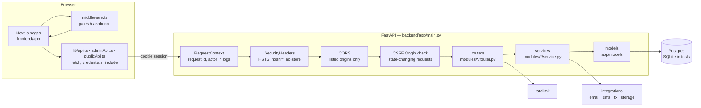
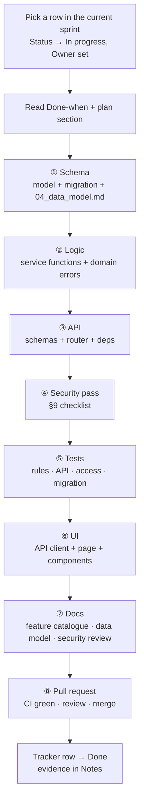
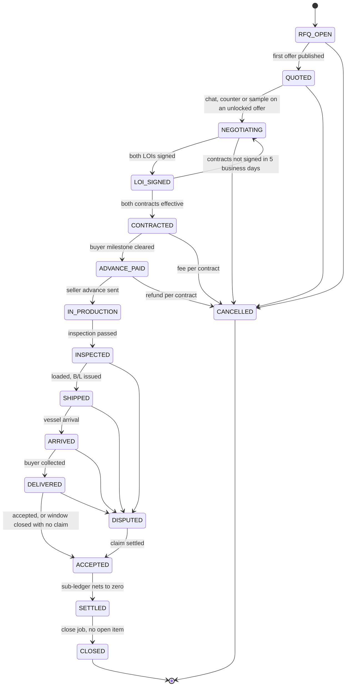

# Cor1x — development flow

**How a feature goes from a tracker row to Done**, and how the API, schema,
business logic, security and UI fit together while it does. Written from the
code on `main` @ `90ef21f`; every path and name below exists today unless it is
marked *new*.

Read it with the two documents it connects:

| Document | Answers | Where |
|---|---|---|
| **Build plan** | *What* the platform does, section by section | `build-plan-final.html` (sections 01–22) |
| **Tracker** | *Which* piece is next, who has it, when it is due, how we know it is done | `docs/tracker/` — sheets *Tracker* and *Roadmap* |
| **This document** | *How* to build any piece the same way every time | `docs/07_development_flow.md` |

A tracker row names its plan section (`plan 3.7`), its milestone (`M1`), its
epic (`E05`) and sprint (`S3`), and states **Done when** — the acceptance
criteria. An epic is the group of rows that together deliver one capability
inside a milestone; the Roadmap sheet lists all 25 with their goals. This
document is the route from there to merged.

---

## Contents

1. [The system at a glance](#1-the-system-at-a-glance)
2. [Repository map](#2-repository-map)
3. [Backend layers and their rules](#3-backend-layers-and-their-rules)
4. [The feature flow — tracker row to Done](#4-the-feature-flow--tracker-row-to-done)
5. [Worked example — CX-071 listing review](#5-worked-example--cx-071-listing-review)
6. [API conventions and the current API map](#6-api-conventions-and-the-current-api-map)
7. [Schema and migration rules](#7-schema-and-migration-rules)
8. [Business logic rules](#8-business-logic-rules)
9. [Security checklist for every pull request](#9-security-checklist-for-every-pull-request)
10. [Frontend conventions](#10-frontend-conventions)
11. [Testing](#11-testing)
12. [Running it locally](#12-running-it-locally)
13. [Definition of done](#13-definition-of-done)
14. [Where each milestone lands in the code](#14-where-each-milestone-lands-in-the-code)
15. [Keeping the documents in step](#15-keeping-the-documents-in-step)

---

## 1. The system at a glance



**Request path.** A page calls a typed function in one of three API clients.
The browser sends the HttpOnly session cookie automatically. The request passes
four middleware layers, outermost first, reaches a thin router, which calls a
service, which reads and writes models. Errors raised in the service become
`{"detail": "..."}` responses in one central handler.

**Startup.** `create_app()` refuses to start a non-debug deployment on
development defaults or without real encryption keys, configures every
integration once from settings, then mounts the routers. Nothing configures
itself lazily on a request.

**Two audiences, two sessions.** Traders use the `cor1x_session` cookie and
`/dashboard`; Corridor staff use `cor1x_admin` and `/admin`. They never share a
session, a login page or a permission model.

---

## 2. Repository map

```
corridor_1_x/
├── backend/
│   ├── app/
│   │   ├── main.py              app factory: config checks, integrations, middleware, routers
│   │   ├── core/                config · security (sessions) · crypto (AES-256-GCM) · csrf
│   │   │                        headers · errors · logging · db · time
│   │   ├── models/              SQLAlchemy tables — one file per table
│   │   ├── modules/<area>/      one folder per feature area (see §3)
│   │   ├── shared/              cross-module helpers: files, schemas, countries, normalize
│   │   ├── integrations/        email, sms, fx, storage, lookups — swappable providers
│   │   ├── notifications/       outbound email templates
│   │   └── ratelimit/           RateLimitRule + limiter (in-memory; Redis in Phase B)
│   ├── alembic/versions/        0001 … 0024 — numbered, never edited once merged
│   ├── scripts/                 init_local_db.py and other one-off tools
│   └── tests/                   pytest + httpx against the ASGI app; tests/qa = flow tests
├── frontend/
│   ├── app/                     Next.js App Router — /dashboard, /products, /admin, /login …
│   ├── components/<area>/       account · admin · auth · business · market · products · shell · ui …
│   ├── lib/                     api.ts · adminApi.ts · publicApi.ts · validation.ts · useMe.ts …
│   ├── middleware.ts            redirects signed-out users away from /dashboard
│   └── DESIGN.md                trader-side design rules
├── docs/
│   ├── 03_admin_design_system.md
│   ├── 04_data_model.md         target schema — update with every migration
│   ├── 05_security_review.md    controls A1… / B1… / C1… and their phases
│   ├── 06_feature_catalogue.md  customer-facing list of what is built
│   ├── 07_development_flow.md   this file
│   └── tracker/                 cor1x-tracker.xlsx + index.html dashboard
└── .claude/launch.json          run configs: frontend, backend, tracker
```

---

## 3. Backend layers and their rules

Each feature area under `backend/app/modules/` has the same five files. The rule
that matters most is in the right-hand column: what each layer **never** does.

| Layer | File | Does | Never does |
|---|---|---|---|
| **Model** | `app/models/<table>.py` | Columns, foreign keys, `CheckConstraint`s, indexes, soft-delete column | Business rules, HTTP, validation messages |
| **Migration** | `alembic/versions/00NN_<name>.py` | Moves the database from one revision to the next, with backfill | Get edited after merge |
| **Schema** | `modules/<area>/schemas.py` | Pydantic request and response shapes, camelCase aliases, `*_to_read()` mappers | Return ORM objects to the router |
| **Service** | `modules/<area>/service.py` | Every business rule; raises `DomainError` subclasses from `core/errors.py` | Import FastAPI, read cookies, build responses |
| **Router** | `modules/<area>/router.py` | Declares the route, its auth dependency, its response model; calls one service function | Contain an `if` about business rules |
| **Deps** | `modules/<area>/deps.py` | Authentication and permission dependencies as `Annotated` aliases | Anything else |

**Why services raise instead of returning HTTP.** `core/errors.py` defines
`BadRequest` (400), `Unauthorized` (401), `Forbidden` (403), `NotFound` (404),
`Conflict` (409) and friends. A service raises them with a message; the central
handler turns them into `{"detail": "..."}`, which is what the frontend's
`ApiError` reads. That keeps services testable without HTTP and keeps every
error the same shape.

**Dependencies you will use.**

```python
# Traders — app/modules/auth/deps.py
CurrentUser       # signed-in trader, 401 otherwise
OptionalUser      # trader or None, for public routes that personalise
DbSession         # AsyncSession for this request

# Corridor staff — app/modules/admin/deps.py
CanReviewKyb, CanViewSensitive, CanManageCatalog, …   # one alias per permission
SignedInAdmin     # any admin, no specific permission
```

**Admin permissions are deny-by-default.** `admin/permissions.py` lists every
`Perm` and which role holds it. Every `/admin` route depends on exactly one
`Can…` alias, and the route-matrix test in `tests/test_admin_accounts.py` fails
if one does not. Adding a role is a row in `ROLE_PERMISSIONS`; adding a
permission is an enum member, an alias in `deps.py`, and the role rows that
should hold it.

**Integrations are configured, not imported.** `email`, `sms`, `fx` and
`storage` each have a config object built from settings in
`main.configure_integrations()`. Code calls the module's interface and never
knows which provider is behind it — which is what lets Phase B swap local disk
for encrypted object storage (CX-131) without touching callers.

---

## 4. The feature flow — tracker row to Done



Backend before frontend, always. The UI is built against an API that already
passes its tests, so a frontend change never discovers a missing rule.

### ① Schema

1. Change or add the model in `app/models/`. Constraints belong in the database
   — a `CheckConstraint` for allowed values, `NOT NULL` where the rule is
   absolute, a unique index where uniqueness is a rule. The app validates too,
   but the database is the last line.
2. Create the migration: `alembic revision -m "describe change"`, then rename
   the file to the next number — `00NN_short_name.py` — and set `revision` to
   match. Write the docstring the way `0023_countries.py` does: what changes,
   the `04_data_model.md` section it implements, whether it is portable and
   reversible.
3. If existing rows need values, **backfill in the same migration**. A new
   `NOT NULL` column without a backfill fails on the first real database.
4. If the migration moves data, add `tests/test_migration_00NN.py`, as
   `test_migration_0019.py` through `0023` do.
5. Update the table's section in `docs/04_data_model.md`.

### ② Logic

1. Write service functions that take a `DbSession`, the acting principal and a
   validated payload, and return model objects.
2. Raise `core/errors` exceptions with a message a user can act on.
3. Keep state transitions in **one function per entity** (see §8). A route
   never sets a `status` column directly.
4. Write audit rows for anything an admin does, with
   `admin.service.record_action(db, admin=…, action="area.verb", target_type=…, target_id=…, details={…})`.

### ③ API

1. Request and response models in `schemas.py`, with camelCase aliases; add a
   `*_to_read()` mapper rather than building responses in the router.
2. The route: one auth alias, `response_model=…, response_model_by_alias=True`,
   an explicit `status_code` for creates (201) and deletes (204), IDs parsed
   with `parse_uuid`.
3. Sensitive or abusable routes get a `RateLimitRule` and
   `await get_limiter().check(rule, key)` before doing anything.
4. A new router is registered in the tuple at the end of `create_app()`.

### ④ Security pass

Run §9 against the diff. It is a checklist, not a review meeting: most items
are a yes in seconds, and a no is a bug found before review.

### ⑤ Tests

See §11. At minimum: the rule, the API happy path, the main refusal, and —
for anything a business owns — the cross-business test that a stranger gets
404, not 403.

### ⑥ UI

1. Add the response type and the call to the right client: `lib/api.ts`
   (traders), `lib/adminApi.ts` (console) or `lib/publicApi.ts` (signed out).
2. Pages under `frontend/app/`, components under `frontend/components/<area>/`,
   primitives from `components/ui/`.
3. Handle `ApiError` by showing its message; never parse error text.
4. Mirror validation in `lib/validation.ts` for fast feedback — the backend
   stays the authority.

### ⑦ Docs

- **Customer-visible?** Add a line to `docs/06_feature_catalogue.md` in plain
  language, with ✅.
- **Schema changed?** `docs/04_data_model.md`.
- **A security control changed?** Update its row in `docs/05_security_review.md`.

### ⑧ Pull request

- Branch from `main`: `feat/cx-071-listing-review`, `fix/cx-067-exif`.
- Title starts with the row ID: `CX-071 Listing review workflow`.
- CI must be green (CX-063 puts it in place in S1).
- The description pastes the row's **Done when** and ticks each line with
  evidence.

After merge, the row goes to **Done** with the commit hash in Notes.

---

## 5. Worked example — CX-071 listing review

The first feature after M0 that touches every layer, and it follows patterns
that already exist. **Done when:** *products.status Draft / Under review /
Published / Rejected; only Published appear in the market; editing a Published
listing re-enters review while the live version stays; tests cover each
transition.*

**① Schema — `app/models/product.py`, new migration**

```python
# app/models/product.py — new column and constraint
status: Mapped[str] = mapped_column(String(20), nullable=False,
                                    default="draft", server_default="draft")
review_reason: Mapped[str | None] = mapped_column(Text(), nullable=True)
# in __table_args__:
CheckConstraint("status IN ('draft', 'under_review', 'published', 'rejected')",
                name="ck_products_status"),
```

```python
# alembic/versions/00NN_listing_review.py — the backfill is the part people forget
op.add_column("products", sa.Column("status", sa.String(20),
              nullable=False, server_default="draft"))
# Listings already in the market stay in the market:
op.execute("""
    UPDATE products SET status = 'published'
    WHERE deleted_at IS NULL AND business_id IN (
        SELECT id FROM businesses WHERE verification_status = 'verified')
""")
```

Then add `status` to the `products` section of `docs/04_data_model.md`, and
update the `ix_products_market*` partial indexes to include
`status = 'published'`.

**② Logic — `modules/catalog/service.py`**

```python
ALLOWED = {
    "draft":        {"under_review"},
    "under_review": {"published", "rejected"},
    "rejected":     {"under_review"},
    "published":    {"under_review"},   # an edit re-enters review
}

def _move(product: Product, to: str) -> None:
    if to not in ALLOWED[product.status]:
        raise Conflict(f"A {product.status} listing cannot move to {to}.")
    product.status = to
```

The market query in `catalog/queries.py` gains `Product.status == "published"`.
The "live version stays during re-review" rule means an edit to a published
listing writes a pending revision rather than changing the live row — decide
the storage (a `product_revisions` table, or a JSON `pending_changes` column)
before writing code, and record it in `04_data_model.md`.

**③ API — a new permission and an admin route**

```python
# admin/permissions.py
listings_review = "listings.review"        # new Perm member, add to REVIEWER

# admin/deps.py
CanReviewListings = Annotated[AdminPrincipal, Depends(require(Perm.listings_review))]

# admin/products.py (new) — mounted in admin/router.py, so the path is /admin/products/…
@router.post("/products/{product_id}/approve", response_model=ListingRow,
             response_model_by_alias=True)
async def approve(product_id: str, admin: CanReviewListings, db: DbSession) -> ListingRow:
    product = await service.approve_listing(db, parse_uuid(product_id))
    record_action(db, admin=admin, action="listing.approve",
                  target_type="product", target_id=product.id, details={})
    await db.commit()
    return listing_to_row(product)
```

The route-matrix test will fail until `approve` declares `CanReviewListings` —
which is the point.

**④ Security pass.** Seller can only submit their own listing (ownership →
404 for strangers); only `listings.review` can approve; rejection reason shown
to the seller contains nothing about the reviewer; the public payload is
unchanged except for fewer rows.

**⑤ Tests — `tests/test_catalog.py`**

```python
async def test_listing_needs_review_before_market(client, make_client, admin_client):
    await signup_and_login(client, "rv@kaverifoods.in")
    # … verified business, create a listing …
    assert (await make_client().get("/public/products")).json()["items"] == []
    # admin approves → visible
    # seller edits → still visible (live version), new revision under review
    # stranger cannot submit someone else's listing → 404
```

**⑥ UI.** `adminApi.ts` gains `listListingsForReview`, `approveListing`,
`rejectListing`; the queue reuses `BusinessReviewView` and `RejectSheet`
patterns (CX-072). The seller's product list shows a status chip and the
rejection reason inline.

**⑦ Docs.** Feature catalogue §1.4: *"✅ Every listing is reviewed by Corridor
before it appears in the market; edits are re-reviewed while the live version
stays up."*

---

## 6. API conventions and the current API map

**Conventions**

| Topic | Rule |
|---|---|
| Paths | Plural nouns; `/me/...` for the signed-in trader's own data; `/public/...` for anonymous; `/admin/...` for the console |
| Bodies | camelCase in JSON via Pydantic aliases; snake_case in Python |
| IDs | UUIDs in paths, parsed with `parse_uuid`, which returns `None` for a malformed value; the service lookup then finds nothing and raises `NotFound`. A bad ID is a 404, never a 500 — so never call `uuid.UUID()` on a path value yourself |
| Version | Every route is under `/v1` except `/health`; the frontend adds it in `lib/apiBase.ts` |
| Errors | `{"detail": "message", "code": "stable.code", "fields"?: [...]}` from `core/errors.py` exceptions; `detail` is always a string, clients branch on `code` |
| Unknown fields | A request body field the API does not know returns 422 `request.unknown_field` (`RequestModel`) |
| Not yours | Return **404**, not 403, when a resource belongs to another business — no existence leak (control B2) |
| Auth | HttpOnly cookies only; no token ever reaches JavaScript |
| State changes | POST / PATCH / PUT / DELETE pass the CSRF Origin check; GET never changes state |
| Abuse | `RateLimitRule("area.action:scope", limit=…, window_sec=…)` on sign-in, reveal, upload and anything paid |
| Money (M5 on) | Every payment endpoint takes an `Idempotency-Key` header; replays are no-ops |
| Files | Content-sniffed, size-limited, served through `shared/files.file_response` with `nosniff` |

**Current map — 76 route handlers**

| Area | Prefix | Routes | What lives there |
|---|---|---|---|
| Auth | `/auth` | 11 | sign-up (code, verify, complete), login, password forgot / reset / change, logout, logout-all, session, security overview |
| Account | `/me`, `/onboarding`, `/uploads/branding` | 12 | profile, business profile and slots, submit for verification, delete account, onboarding steps |
| KYB | `/kyb`, `/me/verification-docs` | 8 | countries and document types (read), a trader's KYB entries: add, edit, reveal, file, delete |
| Catalog | `/products`, `/public`, `/uploads/products` | 9 | own listings, photo upload, contact reveal, public market and facets |
| FX | `/public/fx` | 1 | display rates |
| Lookups | `/pincode`, `/ifsc` | 2 | address and bank-branch lookups |
| Health | `/health` | 1 | liveness |
| Admin | `/admin/...` | 32 | admin auth, dashboard, users and review, documents, countries and document types, admin accounts and trader security |

Sections 05–16 of the build plan add roughly six new areas — deals, RFQs,
quotes, negotiation, contracts, payments — each following the same five-file
module shape. §14 lists where.

---

## 7. Schema and migration rules

| Rule | Why |
|---|---|
| Migrations are numbered `00NN_name` and the revision ID equals the file name | Readable history; `alembic upgrade 0023_countries` means something |
| Never edit a merged migration — write a new one | Someone's database is already at that revision |
| `0001`–`0017` are Postgres-only; `0018` onward must run on Postgres **and** SQLite | Tests run on SQLite; use batch operations for SQLite `ALTER` |
| Every migration is reversible unless its docstring says why not | Rollback in production is a downgrade, not a restore |
| UUID primary keys; `created_at` / `updated_at` via `UTCDateTime`; soft delete with `deleted_at` | Matches every existing table |
| Allowed values are a `CheckConstraint`, e.g. `ck_products_category` | The database refuses what the app forgets |
| Partial indexes for live rows: `WHERE deleted_at IS NULL` | Market queries never scan deleted rows |
| Sensitive values: ciphertext + key version (`core/crypto.py`), a keyed hash for uniqueness, last 4 for display | Control C1; the pattern `business_documents` already uses |
| Listing prices are `Numeric(12,2)` today; **ledger amounts from M5 are integer minor units + ISO 4217 code** | Floats and decimals drift in sums; a ledger must net to exactly zero |
| A schema change is not done until `docs/04_data_model.md` says so | That document is the target schema the next person reads |

Before a deploy: `CX-003` — run the migrations against a copy of the
production database, not only against an empty one.

---

## 8. Business logic rules

These apply from M1 onward and are what keeps sections 05–16 of the plan
buildable by more than one person.

**One place per state machine.** Every entity with a `status` — listing,
business, deal, LOI, contract, claim, payout — has one transition function
holding an allowed-moves table. Routes and jobs call it; nothing else assigns
`status`. Every successful move writes an audit row.

**The deal state machine** (target for CX-089 — the build plan references these
states throughout but defines the machine here):



**Money.** Integer minor units and an ISO 4217 code on every amount. No floats
anywhere. FX conversion happens once, on the cost sheet, with the rate stored
(plan 6.3). The trade ledger and the credit ledger are separate (plan 17.1).

**Time.** Store UTC (`core/time.py`, `UTCDateTime`). SLAs are business days from
a working-day calendar, not wall-clock hours.

**Money moves only on verified events.** Funds are cleared only on the bank's
final-credit confirmation, never on an uploaded screenshot. Documents release
only when the funding milestone is cleared, and no admin path overrides it
(plan 13.1). Every payout and release needs two distinct approvers.

**Masking is a boundary, not a filter (from M2).** Code outside the masking
service holds company **codes**. Reading a real name is a call that is
permission-checked, deal-scoped and audited. A response schema that could carry
a vault field fails the response-guard test (CX-082).

**Contracts mirror as amounts.** When a remedy is a percentage of contract
value, compare the resulting money on both sides, not the rates (plan 9.1).

---

## 9. Security checklist for every pull request

Control IDs refer to `docs/05_security_review.md`. Tick each in the PR or say
why it does not apply.

**Access**
- [ ] Every new route has an auth dependency; public routes are deliberate and listed in the PR (B1)
- [ ] A resource owned by a business is fetched with the owner in the query; a stranger gets **404** (B2) — with a test
- [ ] Every new `/admin` route declares one `Can…` permission; the route-matrix test passes (B9)
- [ ] Admin actions write `record_action` with a meaningful `action` name (C8)

**Data**
- [ ] No identity, contact, bank or KYB field reaches a response it should not; from M2 the response-guard test passes (B5)
- [ ] Sensitive values are encrypted, masked in lists, revealed only by a separate, rate-limited, audited call (C1, B7)
- [ ] Nothing sensitive is logged — no passwords, codes, KYB numbers, file contents, full IPs (C8)
- [ ] Free text another user will read passes the leak filter (from CX-087)

**Input**
- [ ] Uploads: content sniffed, size-limited, renamed, metadata stripped (from CX-067)
- [ ] Every request field is validated in the schema; length limits on strings
- [ ] State-changing requests are not GET

**Abuse and money**
- [ ] Rate limit on anything that reveals, uploads, signs in, or costs credits
- [ ] Payment endpoints are idempotent; money moves need two approvers (from M5)

**Dependencies**
- [ ] No new package with a known advisory; versions pinned (CX-061, CX-062; CI scanning from CX-134)

---

## 10. Frontend conventions

| Topic | Rule |
|---|---|
| Routing | App Router. Traders under `/dashboard/*` (gated by `middleware.ts`), the market under `/products`, the console under `/admin/*` with its own login |
| Data | One client per audience: `lib/api.ts`, `lib/adminApi.ts`, `lib/publicApi.ts`. All calls go through the shared `fetch` wrapper with `credentials: "include"`; base URL from `NEXT_PUBLIC_API_BASE_URL` |
| Errors | The wrapper throws `ApiError(message, status)`. Show `message`; branch only on `status` |
| Session | `middleware.ts` checks the cookie is *present* and redirects to `/login?next=…`; the backend validates it on every call |
| Components | Grouped by area in `components/`; primitives in `components/ui/`; page frames in `components/shell/` (`TraderShell`, `TowerShell`) |
| Forms | Mirror backend rules in `lib/validation.ts`; guard unsaved edits with `useUnsavedGuard` |
| Current user | `useMe()` |
| Design | `frontend/DESIGN.md` for trader pages, `docs/03_admin_design_system.md` for the console |
| Paid actions (from M2) | One price-on-button component everywhere a credit is spent: *"Unlock · 2 credits · you have 18"* |
| Mobile | Every trader page usable at 375 px wide; tap targets ≥ 44 px |
| Checks | `npm run typecheck` and `npm run lint` clean before a PR |

---

## 11. Testing

Tests run with pytest and httpx against the ASGI app on a temporary SQLite
database, created once per session and cleaned between tests
(`tests/conftest.py`).

**Fixtures and helpers you will reuse**

| Name | Gives you |
|---|---|
| `client` | An httpx client for one trader |
| `make_client()` | A fresh, anonymous client — a second trader or the public |
| `admin_client` | A signed-in super admin |
| `signup_and_login(c, email)` | Runs the full email-code sign-up on a client |
| `fill_mandatory(c)` | Completes the mandatory KYB items |
| `set_status(user_id, status)` | Puts a business directly into a verification state |
| `sent_emails(to)`, `code_from_email(to)` | Read the email outbox in tests |
| `png_bytes()` | A valid tiny image for upload tests |

**What every feature adds**

| Test | Proves |
|---|---|
| Rule | The service enforces the rule, including the edge the Done-when names |
| API | The happy path returns the documented shape and status |
| Refusal | The main wrong input gets the right status and message |
| Access | A stranger gets 404; the wrong admin role gets 403 |
| Migration | Existing rows survive and are backfilled (only when data moves) |
| Flow | `tests/qa/` gains a step when a user journey changes |

Commands:

```bash
cd backend && .venv/bin/pytest -q                 # all tests
cd backend && .venv/bin/pytest tests/test_catalog.py -q
cd frontend && npm run typecheck && npm run lint
```

On Windows use `.venv\Scripts\pytest`.

---

## 12. Running it locally

```bash
# backend
cd backend
python -m venv .venv
.venv/bin/pip install -r requirements-dev.txt     # Windows: .venv\Scripts\pip
cp .env.example .env
.venv/bin/python scripts/init_local_db.py         # fresh SQLite: create_all + stamp head
.venv/bin/uvicorn app.main:app --reload --port 8000

# frontend
cd frontend
npm install
cp .env.example .env.local
npm run dev                                       # http://localhost:3000

# tracker dashboard
python -m http.server 4100 --directory docs/tracker   # http://localhost:4100
```

The same three are in `.claude/launch.json` as `cor1x-backend`,
`cor1x-frontend` and `cor1x-tracker`.

New migration:

```bash
cd backend
.venv/bin/alembic revision -m "describe change"   # then rename to 00NN_name.py
.venv/bin/alembic upgrade head
```

---

## 13. Definition of done

A tracker row is **Done** when all of these are true — not when the code is
written.

- [ ] Every line of the row's **Done when** is met, and the PR shows how
- [ ] Merged to `main` with CI green
- [ ] Tests from §11 added and passing
- [ ] §9 checklist ticked in the PR
- [ ] Migration backfills existing data and is reversible, if there is one
- [ ] `04_data_model.md`, `05_security_review.md` and `06_feature_catalogue.md` updated where they apply
- [ ] Demonstrated on the deployed test environment
- [ ] Tracker row set to **Done** with the commit hash in Notes

---

## 14. Where each milestone lands in the code

| Milestone | Sprints | Plan | New or changed in the code |
|---|---|---|---|
| **M0 Stabilise** | S1 | Now | `requirements.txt`, `package.json`, `.github/workflows/` *(new)* |
| **M1 Phase A close-out** | S2–S3 | 01, 03, 04 | `models/product.py` (status, specs, commercial fields), *new* `category_templates`, `admin/products.py`, `catalog/service.py`, `ProductForm.tsx` |
| **M2 Masking & credits** | S4–S5 | 17, 18 | *new* `modules/masking` + `identity_vault` schema, *new* `modules/credits`, *new* `shared/leakfilter.py`; contact reveal retired |
| **M3 RFQ to offer** | S6–S7 | 05, 06, 20 | *new* `models/deal.py` + `modules/deals` (state machine), *new* `modules/rfq`, *new* `modules/quotes` (quote, cost sheet, offer); admin roles extended |
| **M4 Negotiation to contract** | S8–S9 | 07–09 | *new* `modules/chat`, `modules/negotiation` (counters, term sheet), `modules/samples`, `modules/contracts` (LOIs, mirror validator) |
| **M5 Money & execution** | S10–S12 | 10–14 | *new* `modules/payments`, `modules/ledger`, `modules/inspection`, `modules/logistics`, `modules/execution` (release gate, payouts, settlement) |
| **M6 Disputes & close** | S13 | 15, 16, 21 | *new* `modules/claims`; close job, ratings, PairWatch, compliance calendar |
| **M7 Phase B gate** | S14–S15, ops lane from S4 | 22 | `integrations/storage` (encrypted, scanned), `ratelimit` (Redis), TOTP in `modules/auth`, audit hash chain, infrastructure |

Each new module is the same five files from §3, registered in `create_app()`,
with its own section in `04_data_model.md`.

---

## 15. Keeping the documents in step

| When | Update |
|---|---|
| Starting a row | Tracker: Status **In progress**, Owner |
| Merging a row | Tracker: Status **Done**, commit hash in Notes |
| A schema change merges | `04_data_model.md` |
| A security control changes | `05_security_review.md` — the row's status and evidence |
| A customer-visible feature ships | `06_feature_catalogue.md` |
| A decision is taken | The *Discuss later* row: Status Done, the decision in Notes; update the build plan if it changes scope |
| Sprint review | Reconcile every row in the sprint against `main`; move unfinished rows to the next sprint, never silently |
| Sprint 2 ends | Recalibrate the Roadmap sheet dates with real velocity — the current dates assume today's team size and are estimates |

The tracker is the single source for *what's next*; the build plan for *what it
should do*; the code and these docs for *what it does now*. When two of them
disagree, the disagreement is a tracker row.
